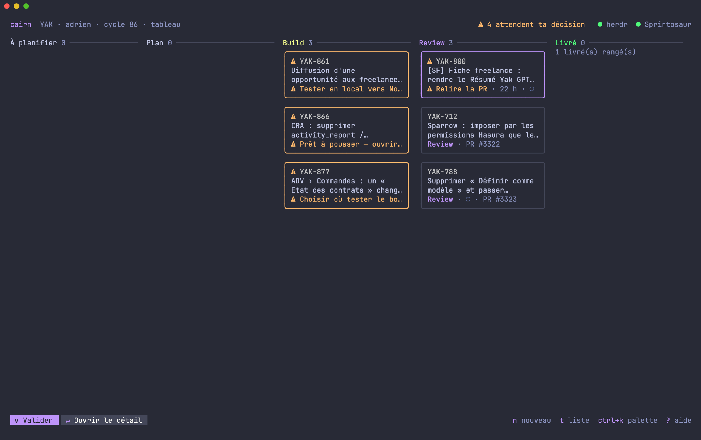

<div align="center">

# cairn

**Know where every ticket stands, without leaving herdr.**

cairn is a mouse-driven TUI that sits next to [herdr](https://herdr.dev).
herdr tells you which agent is working, waiting or asleep. cairn tells you **where the work is**:
the ticket's phase, the plan, the proofs, the PR, and what is waiting for your decision.

One command to remember. Everything else is a button.


</div>

---

<sub>LESS CHECKING IN</sub>

### Stop babysitting terminals.

With five agents on five tickets, herdr shows you five panes. You still have to open each one to find out
whether it is planning, building, stuck on a question, or done and waiting for you.

cairn reads every ticket's state and puts the answer on one screen. The tickets that need you come first,
under **Attend ta décision** ("waiting for your decision"), with the exact thing to decide and the button that decides it.

---

<sub>FROM TICKET TO MERGE</sub>

### Track every ticket end to end.

A ticket in cairn is a **chantier** (French for a work site). It ties together:

- the **ticket**: title, status, priority, estimate, from **Linear**, **Sprintosaur**, or **no tracker at all**
  (the ticket is born in cairn from a title);
- its **git worktree** and its own **herdr workspace**;
- its **agents**, wherever they run;
- its **plan file**, `~/.cairn/chantiers/YAK-123.md`, which the agents keep up to date: phase, tasks, side effects, proofs,
  open questions, what they are waiting for;
- its **pull request**: CI, review, conflicts, comments.

Every chantier moves through **Plan → Build → Review → Shipped**, and cairn shows where it is and since when.


**Several projects, one screen.** cairn follows as many repositories as you like (`cairn add` in each), each with its
own tracker: your work project on Linear, a side project with no tracker at all. Every ticket key says which project it
belongs to (`ENG-42`, `EIDO-7`).

**Start any ticket.** Your open tickets are already listed. `Nouveau ticket` ("new ticket") starts any other: type its
number, or pick one nobody has; it is assigned to you and its plan starts right away. In a project without a tracker,
type a title instead: cairn numbers it (`EIDO-8`) and the plan starts. `tab` switches the project.

**Plan with one click.** `Planifier` creates the worktree and its herdr workspace, starts Claude, and asks for a plan
sized to the ticket. Plans always list their **side effects**: other callers, screens, data, emails. Each one must be
checked off before the PR counts as ready.

**Approve with one click.** When the plan is ready, the chantier jumps to the top. A card at the top of its detail says
what it waits for and since when, with the buttons that do it. Answer the open questions right under them (`› répondre`,
or `e`: your answer goes to the agent as is), press `Valider`, and the agent starts building.

**The screen follows the phase.** While planning, the questions, tasks and side effects come first. While building, what
is in progress and what is left; finished tasks fold away. Before a push, the side effects still to check. In review, the
merge checklist.

---

<sub>NOTHING SHIPS WITHOUT YOU</sub>

### A human go-ahead before every push.

Agents never push or open a PR on their own. When the work is ready, the agent stops and asks
(*Prêt à pousser*, "ready to push"). You press **Autoriser le push** ("allow the push"), check what will leave (commits,
files, side effects still open), and confirm. The go-ahead covers **the commit you reviewed**: the push, the PR, and any
retry go through. Once the PR is open, later pushes (CI fixes, review feedback) pass freely: from then on you review on
the PR, and merging stays yours. One go-ahead per ticket, at the moment the code first leaves.

This is enforced, not just requested. A Claude Code hook (`cairn guard`) blocks `git push` and `gh pr create/ready/merge`
on a chantier's branch until you allow it. Unfinished work stays off the CI pipeline and out of your reviewers' inbox.

---

<sub>READY FOR REVIEW</sub>

### Everything you need to get it merged.


- **Merge checklist.** Tasks done, side effects checked, CI green, review approved, no conflicts, not a draft.
  The list shows `✓ prêt` when everything passes and `✗ CI` when a check breaks.
- **Fix the CI.** When a check fails, `Corriger la CI` fetches the failing steps' logs and hands them to the agent.
- **History.** Every phase change and every decision (plan approved, push allowed, feedback sent) is logged, so you
  can see how long a chantier has been sitting in review.
- **New since your visit.** A cyan `●` marks the chantiers that moved since you last looked: a phase change, or
  someone (an automated reviewer included) commenting or reviewing the PR. The detail lists it, with the review's
  verdict, and the PR conversation opens on the first new message. A chantier counts as seen once you leave it after a
  look of a couple of seconds; your own comments and CI bots are not news.
- **Notifications.** herdr notifies you when a chantier is waiting for you, when the CI breaks, when a review requests
  changes or approves, and when a chantier ships.
- **The tracker follows.** A Linear or Sprintosaur ticket moves to *In Progress* when its plan starts; the tracker's
  GitHub integration takes it from there. Without a tracker, there is nothing to keep in step.
- **Shipped tickets clean up after themselves.** When the PR is merged (GitHub's word, not only the tracker's), the
  chantier leaves the list and cairn removes its worktree and herdr workspace and archives its plan. It only does so
  when nothing can be lost: no uncommitted change, no commit missing from GitHub, no agent at work. Otherwise the
  chantier stays in view with the reason, and **Fermer le chantier** (`x`, "close the ticket") closes it by hand: it
  shows what would be lost (uncommitted files, commits not on GitHub, agents still working), then removes the worktree,
  the herdr workspace and its agents, and archives the plan. Shipped chantiers stay one click away (`› N livré(s)`).

---

<sub>THE REVIEW LOOP</sub>

### Read the PR in the terminal. Send feedback to the agent in one click.


`Commentaires` opens the whole PR conversation full screen: description, comments, reviews, inline comments with
their `file:line`. Markdown is rendered and bot noise is folded away.

- **`[→ agent]`** on any comment sends it to the chantier's agent. The agent adds it as a task, fixes it locally,
  and asks for the next push. If it disagrees, it raises a question in the plan instead.
- **Images in the terminal.** Screenshots in the PR, private GitHub attachments included, are downloaded and shown inline
  through the Kitty graphics protocol (Ghostty, Kitty, WezTerm). Proof captures in the plan open the same way.
- **Broken image links are flagged.** Agents often write `./capture.png`, which GitHub resolves to a dead `/pull/` URL.
  cairn marks those links as broken, and the cairn skill tells agents not to write them.

---

<sub>INSIDE HERDR</sub>

### Part of herdr, not another window.

- cairn lives in **its own herdr workspace**. Click `cairn` in herdr's sidebar or press `prefix+a` to toggle between
  cairn and where you were.
- herdr's sidebar shows each workspace's phase, and under cairn, how many chantiers are waiting for you.
- `enter` on a chantier jumps straight to its agent's pane. `d` opens the branch's diff (browsediff when installed,
  `git diff` otherwise, or any command you set).
- An agent started outside a chantier can be **attached** with one click. cairn names it after the ticket.
- A herdr plugin brings cairn back every time herdr starts.

Everything works with the mouse: click to select, click again to jump to the agent, scroll anywhere, hover the
buttons, hover a chantier to read its agents' state. Each button also has a key, shown on it.

The bottom bar only shows what can be done for the selected chantier, the expected action first. Everything else is one
key away: `ctrl+k` searches every ticket and every action (`val 861`), `?` lists the keys, `/` filters the list, `t`
shows the chantiers as a board by phase. In a narrow pane, cairn shows one pane at a time (`tab` and `esc` switch).



---

<sub>GET STARTED</sub>

### Your first chantier in three steps.

**1. Install.** You need Go, `gh` logged in (`gh auth login`) and herdr.

```sh
git clone https://github.com/Gradrien/cairn.git && cd cairn
./install.sh --herdr
```

The first run asks for a first repository and its tracker. Add more at any time, from inside each repository:

```sh
cairn add                                   # no tracker: tickets are born in cairn (EIDO-1, EIDO-2…)
cairn add --tracker linear --key ENG        # Linear team ENG; export LINEAR_API_KEY (a personal API key)
cairn add --tracker sprintosaur --key YAK   # Sprintosaur, with the sprintosaur skill's credentials
cairn projects                              # what cairn follows
```

`install.sh` also installs the binary, the `cairn` skill for agents, the push guard hook, the herdr plugin, the sidebar
button and `prefix+a`. Run it again after every `git pull`. It also restarts the running cairn.

**2. Plan a ticket.** Open cairn from herdr's sidebar, pick one of your tickets and press `Planifier`, or press
`Nouveau ticket` for any other (or, without a tracker, to write one).

**3. Approve with evidence.** Approve the plan, follow the build, read the proofs, allow the push, then answer the
review from the PR view.

---

<details>
<summary><b>Keys</b></summary>

| Key | Button | Action |
|---|---|---|
| `enter` | Aller à l'agent | jump to the chantier's agent (the one waiting first) |
| `d` | Diff | the branch's diff (`<base>...HEAD`): browsediff, `git diff`, or the project's `diff` command |
| `p` | Planifier | create worktree and workspace, start Claude, ask for the plan |
| `n` | Nouveau ticket | start a ticket outside your list: type its number or pick an unassigned one; without a tracker, type its title (`tab`: other project) |
| `v` | Valider | approve what is waiting (plan approved → Build) |
| `e` | Répondre | answer the plan's open questions; the answer goes to the agent |
| `a` | Autoriser le push | review what will leave, then allow that commit to leave (push, PR, retries; free once the PR is open) |
| `x` | Fermer le chantier | on a shipped ticket: see what would be lost, then remove its worktree and archive its plan |
| `c` | Commentaires | PR conversation and images |
| `f` | Corriger la CI | send the failing CI logs to the agent (shown when CI fails) |
| `o` | Ticket | open the ticket in its tracker |
| `ctrl+k` | palette | search every ticket and action |
| `?` | aide | every key |
| `t` | tableau | board view: chantiers by phase (`←` `→` `↑` `↓`, `enter` opens the detail) |
| `/` | | filter the list (`esc` clears) |
| `tab` | | list ⇄ detail; with the detail focused, `j` `k` scroll it |
| `space` `pgup` | | scroll the detail by a page |
| `[` `]` | | previous / next section of the detail |
| `z` | | unfold / fold everything in the detail |
| `s` | | settings: projects, repositories, keys, trackers |
| `l` | | switch the interface language |
| `r` | | refresh |
| `q` | | back to the previous herdr workspace |

In the PR view: `i` images, `b` bots, `o` open on GitHub, `esc` back. In the image viewer: `←` `→`, `o` open in
Preview, `q` back.

</details>

<details>
<summary><b>Configuration</b></summary>

`~/.cairn/config.json`, written by `cairn add` and by the **settings screen** (`s` in cairn): change a project's
repository, key or tracker, add or remove a project, each change checked and applied at once. cairn opens on that
screen when the config cannot work. One entry per project; only `repo` is required:

```json
{
  "lang": "fr",
  "projects": [
    { "name": "eido", "repo": "~/code/eido", "key": "EIDO", "tracker": "local" },
    { "name": "work", "repo": "~/code/app", "key": "ENG", "tracker": "linear", "diff": "git difftool -d {base}...HEAD" }
  ]
}
```

| Project key | Default |
|---|---|
| `repo` | the main checkout; its worktrees are the chantiers |
| `key` | the ticket prefix, and the team key in Linear or Sprintosaur (default: the folder name, `EIDO`) |
| `name` | the key in lower case |
| `tracker` | `local` (no tracker), `linear` or `sprintosaur` |
| `credentials` | a `KEY=VALUE` file with the tracker's token. Linear: `LINEAR_API_KEY` (the environment variable wins). Sprintosaur: `~/.claude/skills/sprintosaur/credentials.env` (or `SPRINTOSAUR_API` / `SPRINTOSAUR_TOKEN`) |
| `assignee` | your Sprintosaur handle (default: guessed from your git email) |
| `web` | the base URL of issue pages, for Sprintosaur (Linear gives its own) |
| `branch_prefix` | `<assignee>/` |
| `base` | the remote's default branch (`origin/main`) |
| `worktree_parent` | the folder that contains `repo` |
| `agent_kind` | `claude` (also settable for every project at the top level) |
| `diff` | the command `d` runs in the worktree, `{base}` replaced (also settable at the top level) |

At the top level, `lang` is `fr` or `en` (the `l` button sets it). A config from before projects (`repo`, `team`,
`assignee`, `sprintosaur_*` at the top level) still works as one Sprintosaur project; `cairn add` rewrites it in the new
form. If a `repo` is wrong, cairn says so on startup and points to the file.

</details>

<details>
<summary><b>How it works</b></summary>

- **Plan files.** Agents keep `~/.cairn/chantiers/<TICKET>.md` up to date through the `cairn` skill (`skill/SKILL.md`):
  front matter (`phase`, `attente`, `push`), a summary, tasks (`[ ]`, `[~]`, `[x]`), `## Questions`,
  `## Effets de bord` (side effects), `## Preuves` (proofs).
- **Matching.** A worktree belongs to a ticket when its branch contains the key (`eng-123`), with the prefix of the
  project whose repository it is. An agent belongs to it when it works in that worktree, or when its name or title
  mentions the ticket. A PR belongs to it when the tracker links them, or when it comes from the chantier's branch.
- **Phase.** Read from the plan file. Without one, an open PR means Review and a worktree means Build. Merged PRs mean Shipped.
- **Data.** herdr's socket API for agents and workspaces, the tracker's API for tickets (Linear's GraphQL API,
  Sprintosaur's REST API, or the chantier files themselves), `gh` for PRs, CI and images.
  History in `~/.cairn/chantiers/<TICKET>.log`, caches in `~/.cairn/cache/`, archives in `~/.cairn/archive/`.
- **Push guard.** A Claude Code `PreToolUse` hook on Bash. Allowing writes `push: autorisé <commit>` in the plan; the
  hook lets pushes and `gh pr` commands through while the branch's HEAD is that commit. Once the branch has an open PR
  (`gh pr view`), pushes pass whatever the commit; `gh pr merge` still needs the allowance. Claude sessions opened before the install pick the hook up after a restart.

</details>

The interface speaks **French and English**: the `English` / `Français` button (`l`) switches it live and remembers
your choice (`"lang"` in the config). The screenshots above are in French.
