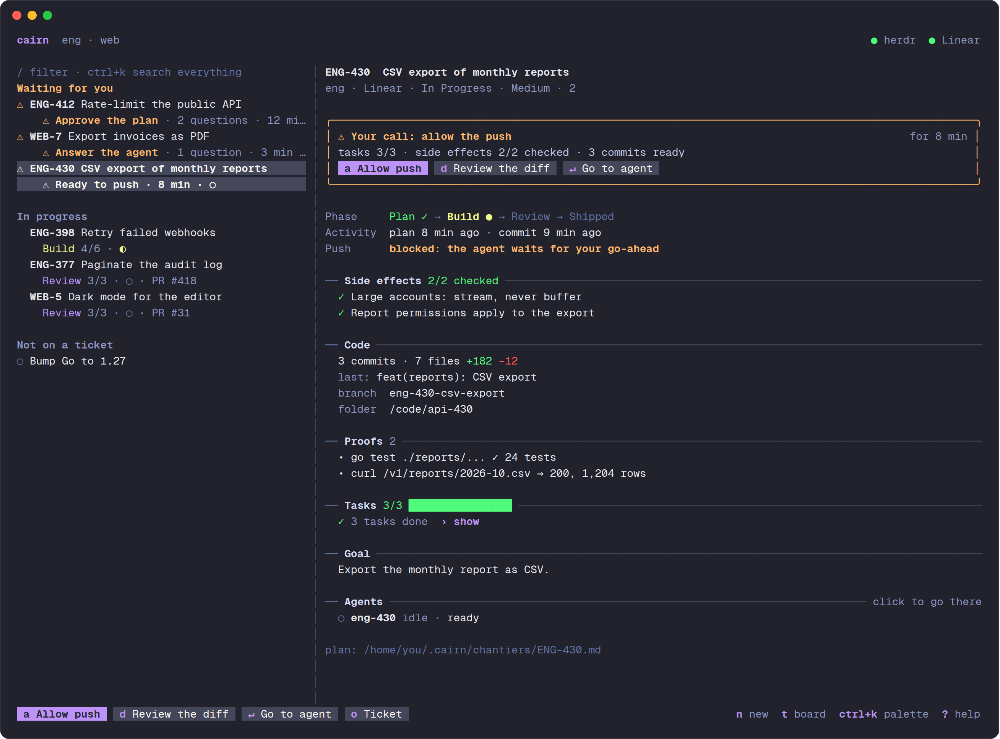
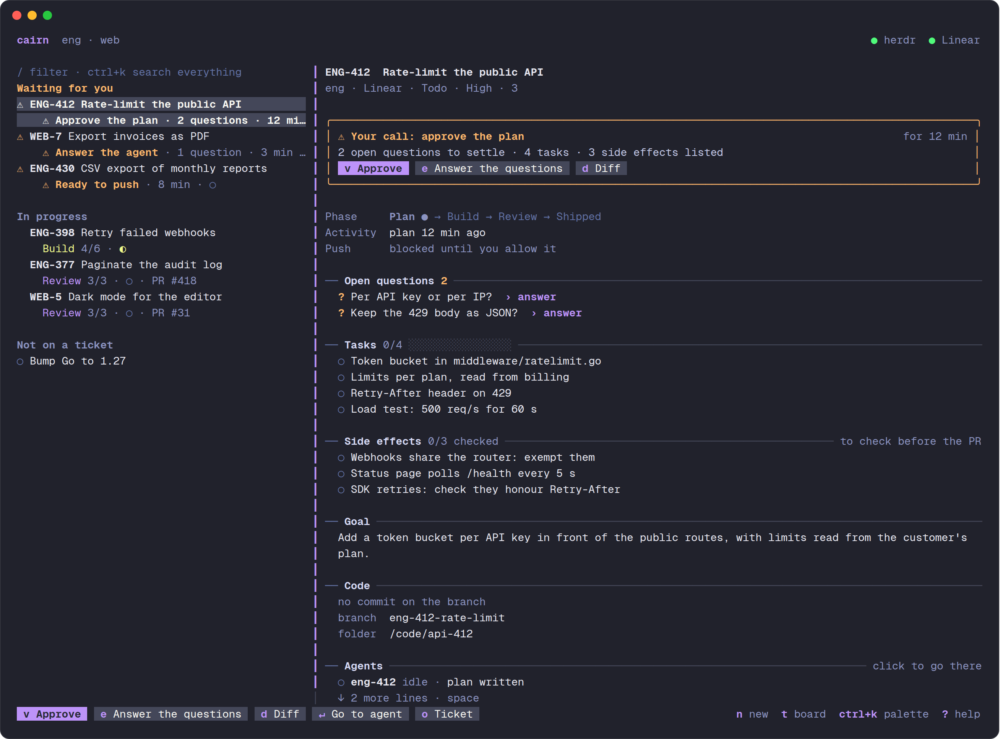
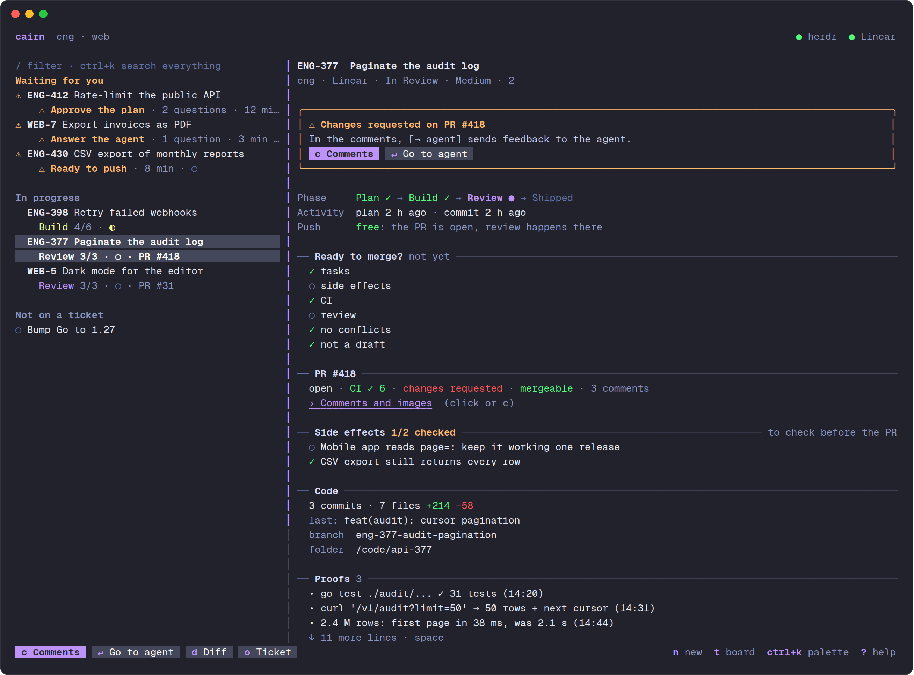
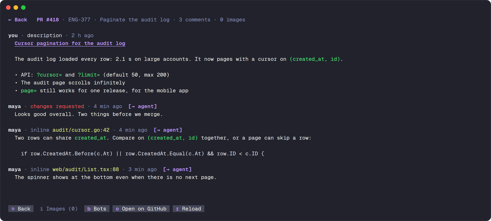

<div align="center">

# cairn

**Know where every ticket stands, without leaving herdr.**

cairn is a mouse-driven TUI that sits next to [herdr](https://herdr.dev).
herdr tells you which agent is working, waiting or asleep. cairn tells you **where the work is**:
the ticket's phase, the plan, the proofs, the PR, and what is waiting for your decision.

One command to remember. Everything else is a button.



</div>

---

<sub>LESS CHECKING IN</sub>

### Stop babysitting terminals.

With five agents on five tickets, herdr shows you five panes. You still have to open each one to find out
whether it is planning, building, stuck on a question, or done and waiting for you.

cairn reads every ticket's state and puts the answer on one screen. The tickets that need you come first,
under **Attend ta décision** ("waiting for your decision"), with the exact thing to decide and the button that decides it.

---

<sub>FROM TICKET TO MERGE</sub>

### Track every ticket end to end.

A ticket in cairn is a **chantier** (French for a work site). It ties together:

- the **Sprintosaur ticket**: title, status, priority, estimate;
- its **git worktree** and its own **herdr workspace**;
- its **agents**, wherever they run;
- its **plan file**, `~/.cairn/chantiers/YAK-123.md`, which the agents keep up to date: phase, tasks, side effects, proofs,
  open questions, what they are waiting for;
- its **pull request**: CI, review, conflicts, comments.

Every chantier moves through **Plan → Build → Review → Shipped**, and cairn shows where it is and since when.



**Plan with one click.** `Planifier` creates the worktree and its herdr workspace, starts Claude, and asks for a plan
sized to the ticket. Plans always list their **side effects**: other callers, screens, data, emails. Each one must be
checked off before the PR counts as ready.

**Approve with one click.** When the plan is ready, the chantier jumps to the top. Read it, answer the open questions,
press `Valider`, and the agent starts building.

---

<sub>NOTHING SHIPS WITHOUT YOU</sub>

### A human go-ahead before every push.

Agents never push or open a PR on their own. When the work is ready, the agent stops and asks
(*Prêt à pousser*, "ready to push"). You press **Autoriser le push** ("allow the push"), and that allows **one** push.

This is enforced, not just requested. A Claude Code hook (`cairn guard`) blocks `git push` and `gh pr create/ready/merge`
on a chantier's branch until you allow it. Unfinished work stays off the CI pipeline and out of your reviewers' inbox.

---

<sub>READY FOR REVIEW</sub>

### Everything you need to get it merged.



- **Merge checklist.** Tasks done, side effects checked, CI green, review approved, no conflicts, not a draft.
  The list shows `✓ prêt` when everything passes and `✗ CI` when a check breaks.
- **Fix the CI.** When a check fails, `Corriger la CI` fetches the failing steps' logs and hands them to the agent.
- **History.** Every phase change and every decision (plan approved, push allowed, feedback sent) is logged, so you
  can see how long a chantier has been sitting in review.
- **Notifications.** herdr notifies you when a chantier is waiting for you, when the CI breaks, when a review requests
  changes or approves, and when a chantier ships.
- **Sprintosaur follows.** A ticket moves to *In Progress* when its plan starts. *Pull Request* and *Done* follow the linked PRs.
- **Put away.** `Ranger` ("put away") closes a chantier whenever you want, shipped or not: it removes its worktree and
  workspace, archives its plan and takes it off the list. A branch checked out in the main repo is left alone, and
  uncommitted changes take one more click. Put-away chantiers stay one click away (`› N rangé(s)`), and planning the
  ticket again brings it back.

---

<sub>THE REVIEW LOOP</sub>

### Read the PR in the terminal. Send feedback to the agent in one click.



`Commentaires` opens the whole PR conversation full screen: description, comments, reviews, inline comments with
their `file:line`. Markdown is rendered and bot noise is folded away.

- **`[→ agent]`** on any comment sends it to the chantier's agent. The agent adds it as a task, fixes it locally,
  and asks for the next push. If it disagrees, it raises a question in the plan instead.
- **Images in the terminal.** Screenshots in the PR, private GitHub attachments included, are downloaded and shown inline
  through the Kitty graphics protocol (Ghostty, Kitty, WezTerm). Proof captures in the plan open the same way.
- **Broken image links are flagged.** Agents often write `./capture.png`, which GitHub resolves to a dead `/pull/` URL.
  cairn marks those links as broken, and the cairn skill tells agents not to write them.

---

<sub>INSIDE HERDR</sub>

### Part of herdr, not another window.

- cairn lives in **its own herdr workspace**. Click `cairn` in herdr's sidebar or press `prefix+a` to toggle between
  cairn and where you were.
- herdr's sidebar shows each workspace's phase, and under cairn, how many chantiers are waiting for you.
- `enter` on a chantier jumps straight to its agent's pane. `d` opens browsediff on the branch.
- An agent started outside a chantier can be **attached** with one click. cairn names it after the ticket.
- A herdr plugin brings cairn back every time herdr starts.

Everything works with the mouse: click to select, click again to jump to the agent, scroll anywhere, hover the
buttons. Each button also has a key, shown on it.

---

<sub>GET STARTED</sub>

### Your first chantier in three steps.

**1. Install.** You need Go, `gh` logged in (`gh auth login`), herdr, and the Sprintosaur skill with its credentials.

```sh
git clone https://github.com/Gradrien/cairn.git && cd cairn
./install.sh --herdr
```

The first run asks for two things: where your Yak-App checkout is, and your Sprintosaur handle (guessed from your
git email). It then installs the binary, the `cairn` skill for agents, the push guard hook, the herdr plugin, the
sidebar button and `prefix+a`. Run `./install.sh` again after every `git pull`. It also restarts the running cairn.

**2. Plan a ticket.** Open cairn from herdr's sidebar, pick a ticket from your current cycle, press `Planifier`.

**3. Approve with evidence.** Approve the plan, follow the build, read the proofs, allow the push, then answer the
review from the PR view.

---

<details>
<summary><b>Keys</b></summary>

| Key | Button | Action |
|---|---|---|
| `enter` | Aller à l'agent | jump to the chantier's agent (the one waiting first) |
| `d` | Diff | browsediff of the branch (`origin/main...HEAD`) |
| `p` | Planifier | create worktree and workspace, start Claude, ask for the plan |
| `v` | Valider | approve what is waiting (plan approved → Build) |
| `a` | Autoriser le push | allow the agent's next push or PR |
| `c` | Commentaires | PR conversation and images |
| `f` | Corriger la CI | send the failing CI logs to the agent (shown when CI fails) |
| `x` | Ranger | put the chantier away: worktree, workspace, plan (two clicks, three with uncommitted changes) |
| `o` | Ticket | open the ticket in Sprintosaur |
| `l` | English / Français | switch the interface language |
| `r` | Rafraîchir | refresh |
| `q` | Quitter | back to the previous herdr workspace |

In the PR view: `i` images, `b` bots, `o` open on GitHub, `esc` back. In the image viewer: `←` `→`, `o` open in
Preview, `q` back.

</details>

<details>
<summary><b>Configuration</b></summary>

`~/.cairn/config.json`. Only `repo` and `assignee` are personal. Everything else defaults to the team's values and
can be overridden:

| Key | Default |
|---|---|
| `repo` | your Yak-App checkout (asked on install) |
| `assignee` | your Sprintosaur handle (asked on install) |
| `team` | `YAK` |
| `branch_prefix` | `<assignee>/` |
| `base` | `origin/main` |
| `worktree_parent` | the folder that contains `repo` |
| `agent_kind` | `claude` |
| `sprintosaur_credentials` | `~/.claude/skills/sprintosaur/credentials.env` (or `SPRINTOSAUR_API` / `SPRINTOSAUR_TOKEN`) |
| `sprintosaur_web` | Sprintosaur's issue URL |
| `lang` | `fr` (or `en`; the `l` button sets it) |

If `repo` is wrong, cairn says so on startup and points to the file.

</details>

<details>
<summary><b>How it works</b></summary>

- **Plan files.** Agents keep `~/.cairn/chantiers/<TICKET>.md` up to date through the `cairn` skill (`skill/SKILL.md`):
  front matter (`phase`, `attente`, `push`), a summary, tasks (`[ ]`, `[~]`, `[x]`), `## Questions`,
  `## Effets de bord` (side effects), `## Preuves` (proofs).
- **Matching.** A worktree belongs to a ticket when its branch contains the key (`yak-123`). An agent belongs to it when
  it works in that worktree, or when its name or title mentions the ticket.
- **Phase.** Read from the plan file. Without one, an open PR means Review and a worktree means Build. Merged PRs mean Shipped.
- **Data.** herdr's socket API for agents and workspaces, Sprintosaur's API for tickets, `gh` for PRs, CI and images.
  History in `~/.cairn/chantiers/<TICKET>.log`, caches in `~/.cairn/cache/`, archives in `~/.cairn/archive/`.
- **Push guard.** A Claude Code `PreToolUse` hook on Bash. An allowed push is consumed when it passes, so every push
  needs its own go-ahead. Claude sessions opened before the install pick the hook up after a restart.

</details>

The interface speaks **French and English**: the `English` / `Français` button (`l`) switches it live and remembers
your choice (`"lang"` in the config). The screenshots above are in French.
